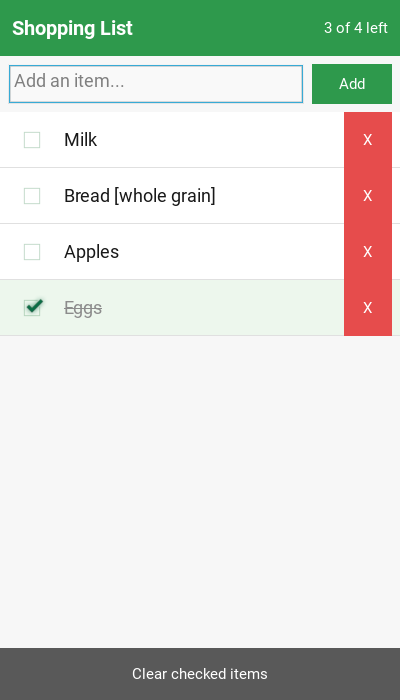

# Shopping List (Python / Kivy)

A simple shopping-list mobile app with check marks, written in Python with
[Kivy](https://kivy.org). It runs on desktop and builds for Android.



## Features
- Add items from the text box (press **Enter** or tap **Add**)
- Tap the checkbox to mark an item as bought. It gets a check mark and
  strikethrough, and moves to the bottom of the list
- Delete a single item with **X**, or tap **Clear checked items** to remove
  everything you've checked
- Header shows a counter such as "3 of 4 left"
- The list is saved automatically to JSON in the app's data directory, so it
  survives restarts

## Run on desktop
```bash
cd shopping_list_app
pip install -r requirements.txt
python main.py
```

## Build an Android APK
Run this on Linux or WSL:
```bash
pip install buildozer cython
cd shopping_list_app
buildozer android debug          # APK is written to bin/
buildozer android deploy run     # install on a USB-connected phone
```
iOS builds are possible with `kivy-ios` on macOS.

## Tests
The list logic (`shopping_list.py`) has no UI dependencies:
```bash
python -m unittest discover -s tests -v
```

## Files
| File | Purpose |
|---|---|
| `main.py` | Kivy UI (layout in an embedded KV string) |
| `shopping_list.py` | Item model, check/uncheck, sorting, JSON persistence |
| `tests/` | Unit tests for the model |
| `buildozer.spec` | Android packaging config |
